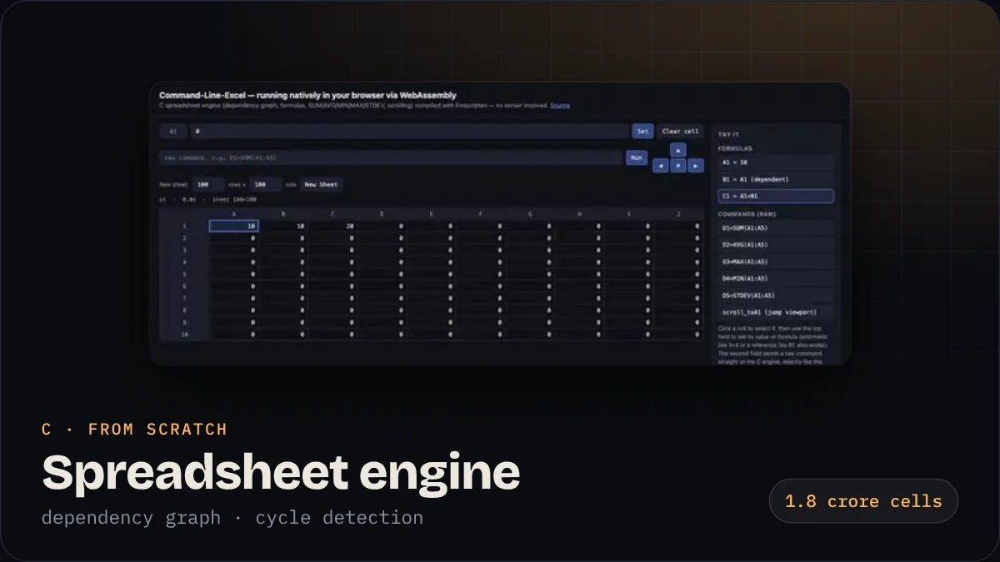
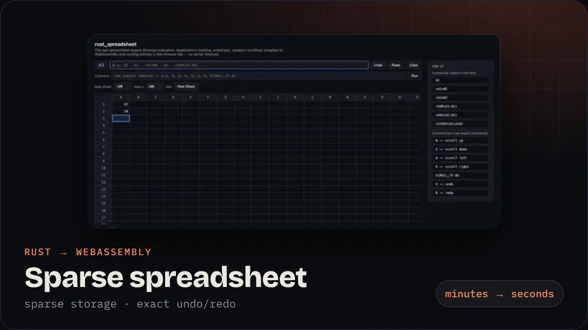
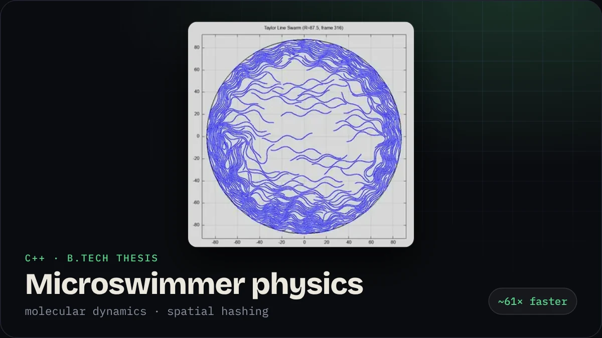
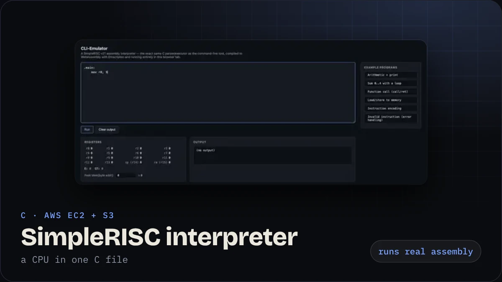
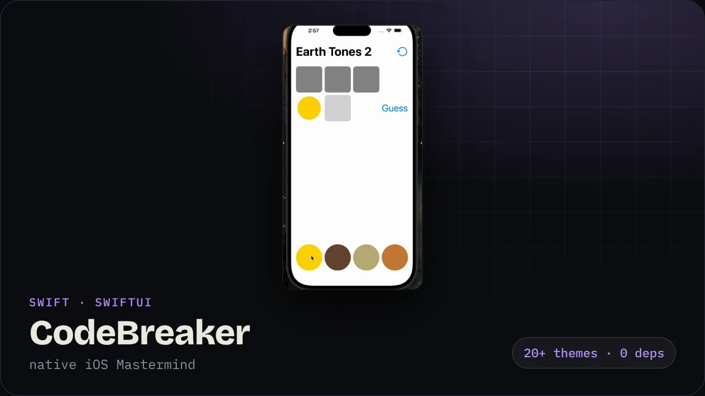
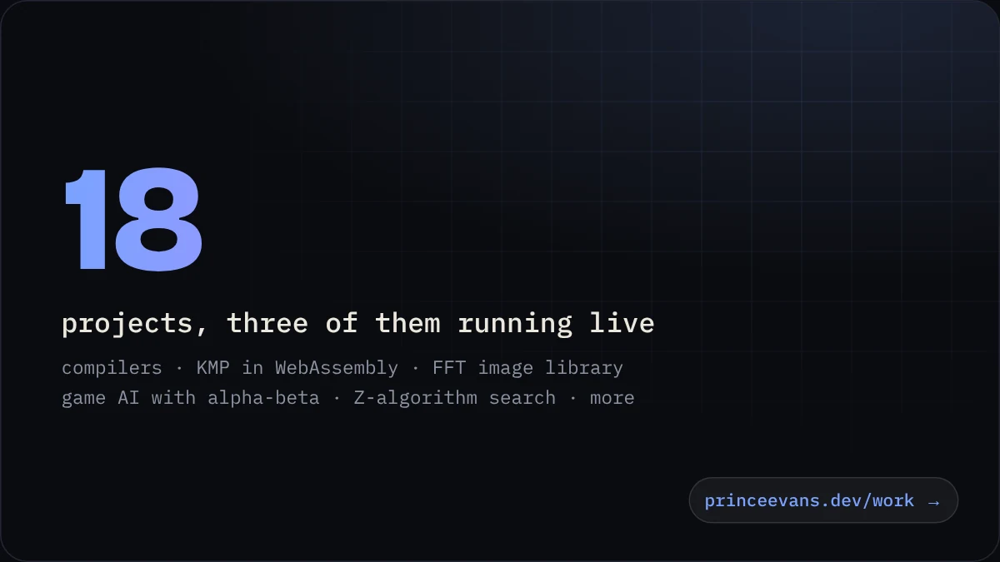

<h1 align="center">Hi, I'm Prince Evans 👋</h1>

<b>I build systems from scratch in C, C++ and Rust, make slow programs fast, and measure the result.</b> Software engineer · IIT Delhi '26 · New Delhi · open to SDE roles, full-time and internships

  
  
  
  

## Things I built that actually run

<table>
  <tr>
    <td width="50%"></td>
    <td width="50%"></td>
  </tr>
  <tr>
    <td><b><a href="https://github.com/evans-prince/Command-Line-Excel">Command-Line-Excel</a></b> · a full spreadsheet engine in plain C that recalculates only what changed. <a href="https://princeevans.dev/work/c-spreadsheet.html">Try it live →</a></td>
    <td><b><a href="https://github.com/evans-prince/rust_spreadsheet">rust_spreadsheet</a></b> · the same idea rebuilt for scale with sparse storage and exact undo/redo. <a href="https://princeevans.dev/work/rust-spreadsheet.html">Try it live →</a></td>
  </tr>
  <tr>
    <td></td>
    <td></td>
  </tr>
  <tr>
    <td><b><a href="https://github.com/evans-prince/Taylor-Line-Swimmers-in-confinement">Taylor-Line microswimmers</a></b> · my B.Tech thesis: a molecular-dynamics engine, ~61× faster with spatial hashing. <a href="https://princeevans.dev/work/taylor-line.html">Case study →</a></td>
    <td><b><a href="https://github.com/evans-prince/CLI-Emulator">CLI-Emulator</a></b> · reads SimpleRISC assembly and runs it, behind an HTTP API on AWS EC2 + S3. <a href="https://princeevans.dev/work/simplerisc.html">Try it live →</a></td>
  </tr>
  <tr>
    <td></td>
    <td></td>
  </tr>
  <tr>
    <td><b><a href="https://github.com/evans-prince/CodeBreaker">CodeBreaker</a></b> · a native iPhone Mastermind game in SwiftUI with 20+ themes. <a href="https://princeevans.dev/work/codebreaker.html">Case study →</a></td>
    <td><b><a href="https://princeevans.dev/work/">All projects</a></b> · compilers, a KMP visualiser in WebAssembly, an FFT image library, game AI and more. <a href="https://princeevans.dev/work/">See them all →</a></td>
  </tr>
</table>

## Live numbers

## How I work

- **Measure first.** If I can't benchmark it, I don't claim it.
- **Build from scratch.** Most of my projects use only the standard library, so I understand every layer.
- **Debug properly.** GDB, LLDB, Valgrind and tests on the core modules.
- **Ship somewhere real.** WebAssembly in the browser, GitHub Pages, AWS EC2 and S3 with IAM roles.

## Toolkit

  
  
  
  
  
  
  
  
  
  
  
  
  

`GDB` `LLDB` `Valgrind` `Make` `Emscripten` `wasm-bindgen` `SwiftUI` `Blender` `Final Cut Pro`

---

Want the full experience? <a href="https://princeevans.dev">princeevans.dev</a> runs three of my real engines in your browser, and there's a little AI called Byte who can answer questions about me.

